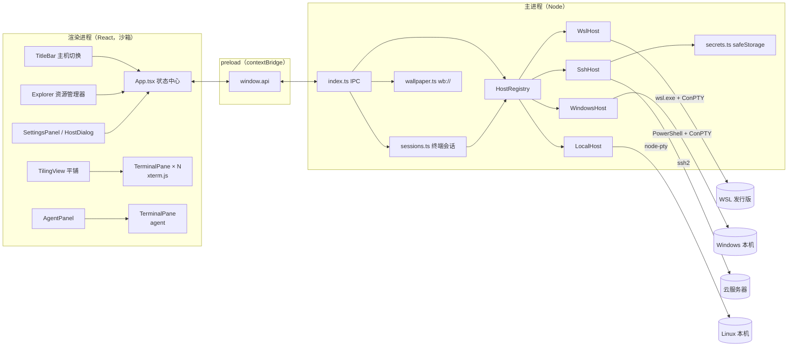
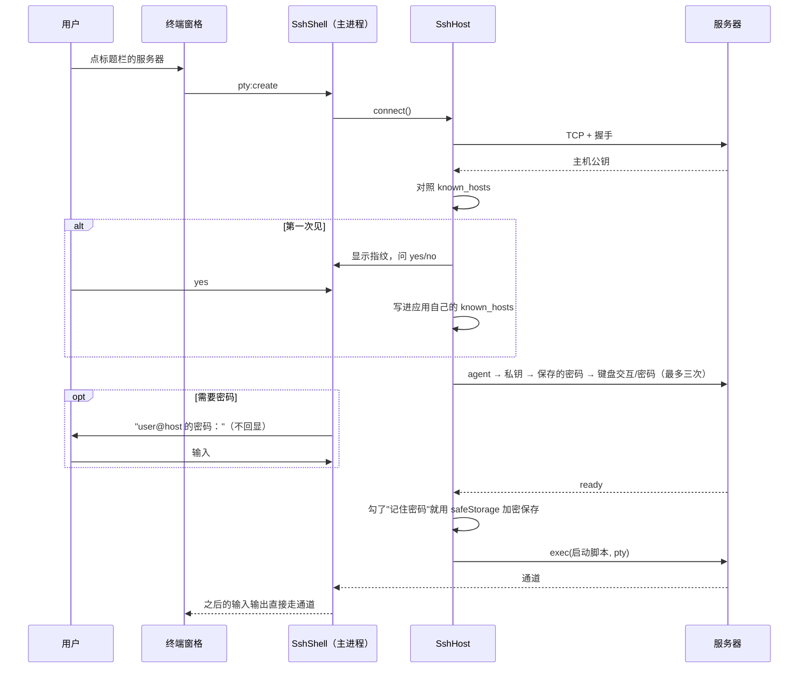

# Linux Workbench 架构

这份文档讲清楚 Linux Workbench 是怎么搭起来的：进程怎么分工、"主机"这层抽象怎么让 WSL、
远程服务器和 Windows 本机用同一套界面操作，以及几个关键流程的来龙去脉。读完应该能找到任何一个功能对应的代码，
也知道要加一种新主机（比如 Docker 容器）该从哪里下手。

## 一句话

一个 Electron 应用：**主进程**管理若干台"主机"，每台主机能开终端、跑命令、列目录；**渲染进程**是 React 界面，
左边资源管理器、中间平铺终端、右边 agent CLI，所有操作都落到"当前焦点终端所在的那台主机"上。

## 总体结构



| 层 | 位置 | 职责 |
| --- | --- | --- |
| 渲染进程 | `src/renderer/src` | 界面和交互状态；不碰系统，所有能力都通过 `window.api` |
| preload | `src/preload` | 用 `contextBridge` 暴露一组明确的函数，渲染进程拿不到 Node 和 `ipcRenderer` |
| 主进程 | `src/main` | 主机、终端会话、文件、密码、壁纸；IPC 入口在 `index.ts` |
| 共享 | `src/shared` | 三端共用的类型、agent 列表、路径引号规则（纯函数，可单测） |

## 主机层：一套接口，四种实现

所有"能操作的地方"都抽象成 `Host`（`src/main/hosts/types.ts`）：

```ts
interface Host {
  readonly flavor: 'posix' | 'powershell'   // 决定 cd 命令和路径引号怎么写
  info(): HostInfo                           // 名字、类型、连接状态
  openShell(opts): ShellHandle               // 开一个交互终端
  exec(script): Promise<{ stdout, code }>    // 跑一段脚本拿结果
  listDir(dir): Promise<DirEntry[]>          // 资源管理器用
  home(): Promise<string>
  detectAgents?(ids): Promise<Map>           // 可选：自己查 agent，否则用通用 sh 脚本
  dispose(): void
}

interface ShellHandle {
  pid: number | null        // 主机上 shell 的 Linux pid（读 /proc 用）
  ready: boolean            // SSH 登录完才 ready
  trackedCwd?(), trackedBusy?()   // 没有 /proc 的主机自己跟踪
  write / resize / kill / onData / onExit
}
```

| 实现 | 终端怎么开 | 命令怎么跑 | 目录怎么列 | 当前目录 / 是否忙 |
| --- | --- | --- | --- | --- |
| `WslHost` | node-pty 起 `wsl.exe -d <发行版>` | 常驻辅助 sh 进程 | sh 脚本 | 读 `/proc` |
| `SshHost` | ssh2 的 exec 通道（带 pty） | ssh2 exec 通道 | sh 脚本 | 读 `/proc` |
| `LocalHost` | node-pty 起 `/bin/sh` | 每次起 sh | Node `fs` | 读 `/proc` |
| `WindowsHost` | node-pty 起 PowerShell | 每次起 PowerShell | Node `fs` | 提示符报告 |

`HostRegistry`（`registry.ts`）负责列出主机：Windows 上是所有 WSL 发行版（排除 docker-desktop）+ 本机 +
保存的 SSH 服务器；Linux 上是本机 + SSH 服务器。SSH 服务器配置存在 `userData/hosts.json`（不含密码）。

### Linux 主机：一个启动脚本解决 pid、目录和登录 shell

三种 Linux 主机开终端时跑的是同一段 sh 脚本（`scripts.ts` 的 `shellLaunchScript`）：

```sh
printf '\033]7777;wb-pid=%s\007' $$        # ① 用一个自定义 OSC 序列报出自己的 pid
printf '\033[H\033[2J\033[3J'               # ② 仅 WSL：清屏，连 ConPTY 的缓冲一起清（见"Windows 上的坑"）
cd -- '<目录>' 2>/dev/null || cd             # ③ 进入目录
s=$(getent passwd "$(id -un)" | cut -d: -f7); export SHELL="$s"
exec "$s" -l                                 # ④ exec 成用户的登录 shell，pid 不变
```

- ① 的序列由主进程的 `PidMarkerFilter` 从输出流里截下来并删掉，用户看不到。
- ④ 用 `exec`，所以之后这个 pid 就是用户的 bash / zsh。拿着它就能：
  - 读 `/proc/<pid>/cwd` 知道终端当前目录（标题栏、资源管理器高亮）
  - 读 `/proc/<pid>/stat` 第 8 个字段 `tpgid`（终端前台进程组）。**前台不是 shell 自己就说明在跑程序**，
    这时双击文件夹不往里打 `cd`，只提示"正在运行 xxx"。比只看进程名可靠：bash 脚本写的程序进程名也叫 bash。
- 开 agent 时最后一行换成 `exec "$s" -ilc 'claude; exec "$SHELL" -il'`：在登录交互 shell 里启动，
  PATH、nvm、ROS 环境和平时一样；agent 退出后留在 shell 里。

这样 WSL、SSH、Linux 本机三种主机只需要提供"开一个跑这段脚本的 pty"和"跑一段 sh 拿输出"两个能力，
cd、当前目录、忙碌判断、agent 检测全是共用的（`sessions.ts`）。

### WSL：脚本怎么送进去、命令怎么跑得快

- **送脚本**：Windows 命令行对引号、`$` 的转义规则和 Linux 完全不同。做法是把脚本放进环境变量 `WB_SCRIPT`，
  用 `WSLENV=WB_SCRIPT/u` 让 WSL 把它带进去，命令行上只有固定的 `wsl.exe -d X --exec sh -c 'eval "$WB_SCRIPT"'`。
- **跑命令**：每次起 `wsl.exe` 要两百多毫秒，展开目录、刷新当前目录会明显发顿。`ExecHelper`（`exec-helper.ts`）
  起一个常驻的 sh，用一行 `<编号> <base64 脚本>` 发命令，回 `输出 \n\x1e<编号> <退出码>\x1e\n`，几毫秒一次。
  超时或进程退出就整体重启。

### SSH：登录界面就是终端本身

`SshHost`（`ssh.ts`）用纯 JS 的 ssh2 库，不依赖系统的 ssh 命令。



- **登录阶段没有远程 shell**：`SshShell` 自己在终端里画提示、收集输入（密码不回显、支持退格和 Ctrl+C 取消），
  登录成功后再接到远程通道上。登录成功到通道开出来之间敲的字先存着、开出来后补发；登录前提前敲的字（可能是密码）不会落进 shell。
- **主机密钥**：兼容 OpenSSH 的 known_hosts（含 `HashKnownHosts` 的哈希条目、通配符、否定、`@revoked`）。
  读用户的 `~/.ssh/known_hosts` 和应用自己的 `userData/known_hosts`，只往后者写。密钥和记录不一致时直接拒绝，提示可能被冒充。
- **共用连接**：同一台服务器的所有终端、资源管理器、cd、agent 检测共用一个 ssh2 连接，只登录一次。
- **断线**：远程 shell 自己 `exit` 就关窗格；没有退出码就是连接断了，窗格留着，提示"按回车重新连接"。
- **记住密码**（`secrets.ts`）：用 Electron 的 `safeStorage`（Windows 上是 DPAPI，只有当前 Windows 用户能解开），
  `userData/secrets.json` 里只有密文；系统不支持加密就不存。下次连接先用保存的密码，失败再问，问对了更新保存的密码。

### Windows 本机：没有 /proc 怎么办

`WindowsHost`（`windows.ts`）开 PowerShell（装了 PowerShell 7 用 pwsh）。

- **送脚本**：`-NoExit -EncodedCommand <UTF-16LE base64>`，同样避开命令行转义。
- **当前目录**：启动脚本（`ps-scripts.ts`）包一层用户原有的 `prompt` 函数，每次出提示符时先输出
  `ESC ] 9;9;<当前目录> BEL`（Windows Terminal 用的同一个序列）。`PromptTracker` 从输出里截下来并删掉，
  序列被拆在两个数据块里也能拼上。
- **是否忙**：按回车 → 忙；下一个提示符出现 → 空闲。启动到第一个提示符之前也算忙，所以 agent 运行期间双击 cd 会被拦住。
- **agent**：`Get-Command claude -CommandType Application` 只找 exe / cmd，不走 `.ps1`，免得被执行策略拦住。

## 会话层和 IPC

`sessions.ts` 维护 `会话编号 → { host, shell }`，把主机能力包装成 IPC：

| 通道 | 方向 | 作用 |
| --- | --- | --- |
| `pty:create` | 渲染 → 主 | 在某台主机上开终端（可指定 agent），返回会话编号 |
| `pty:write` / `pty:resize` / `pty:kill` | 渲染 → 主 | 输入、改尺寸、关闭 |
| `pty:data` / `pty:exit` | 主 → 渲染 | 输出、退出 |
| `pty:cd` | 渲染 → 主 | 先判断忙不忙，再按主机类型发 `cd` 或 `Set-Location` |
| `pty:cwd` | 渲染 → 主 | 当前目录（`/proc` 或提示符报告） |
| `hosts:list` / `saveSsh` / `remove` / `home` … | 渲染 → 主 | 主机管理 |
| `hosts:status` | 主 → 渲染 | 连接状态变化（标题栏的状态点） |
| `fs:list` | 渲染 → 主 | 列目录 |
| `agents:detect` | 渲染 → 主 | 查某台主机装了哪些 agent |
| `wallpaper:*` | 渲染 → 主 | 选图、读当前壁纸地址、移除 |

窗口用 `contextIsolation + sandbox`，preload 只暴露上面这些函数。去掉了 Electron 默认菜单，
否则 Ctrl+W（关窗口）、Ctrl+R（刷新）、Ctrl+M（最小化）会抢走终端里本该给 shell 的按键。

## 渲染层

### 状态和焦点模型

状态集中在 `App.tsx`：主机列表、每台主机的 home 和资源管理器根目录、平铺布局、焦点、agent 面板、设置。

核心规则：**"当前主机" = 焦点终端所在的主机**（agent 面板获得焦点时就是 agent 的主机）。资源管理器显示它、
双击 cd 和拖放路径作用在它上面。点标题栏的主机：那台主机上已经有终端就切过去（按最近使用），没有就新开一个。

### 平铺布局

- `layout.ts`：二叉分割树，`{ split: row|column, ratio, a, b } | { pane }`。拆分、关闭、调比例、
  关闭后焦点交给谁，全是纯函数，有单元测试。拆分沿较长的边对半切（和 bspwm 的 dwindle 一样）。
- `TilingView.tsx`：**所有窗格平铺在同一层，按计算出的矩形绝对定位**。树怎么变终端组件都不会卸载重建
  （终端进程不受影响），位置变化交给 CSS transition 做动画；关闭的窗格留一个空壳做退场动画。
- 尺寸在动画、拖动期间每帧都在变，`TerminalPane` 停下来 80ms 才重算行列，免得 shell 每帧都重排输出。

### 终端窗格

`TerminalPane.tsx` 包一个 xterm.js：背景透明透出壁纸，Catppuccin Mocha 配色；输出停下 300ms 后问一次当前目录；
有选中内容时 Ctrl+C 复制、Ctrl+V 粘贴；只接受**同一台主机**的资源管理器拖来的路径——主机编号编进了
dataTransfer 的类型名里，因为拖动过程中读不到数据、只能看类型。

### 设置和外观

`settings.ts` 定义默认值（按 16 寸屏 150% 缩放：界面 14px、终端 15px）、内置渐变壁纸、强调色。设置写成 `:root` 上的
CSS 变量，改了立刻生效。自选的壁纸由主进程复制进 `userData/wallpaper/`，通过自定义协议 `wb://` 提供给页面，页面不直接读本地文件。

视觉参考 [openbit/wsl-sway](https://gitee.com/openbit/wsl-sway) 的 niri 配置：8px 间距、1.5px 强调色焦点描边、
`0 5px 30px` 的柔和阴影、半透明毛玻璃面板。

## Windows 上的坑

| 现象 | 原因 | 处理 |
| --- | --- | --- |
| 每个 WSL 终端开头一行 `wsl: A localhost proxy…` | Windows 开了代理、WSL 是 NAT 模式，wsl.exe 启动时打的警告 | pid 标记之前的输出全丢掉（那只可能是 wsl.exe 自己打的） |
| 丢掉之后，改终端尺寸那行又出现了 | ConPTY 自己维护一份屏幕缓冲，改尺寸时按缓冲重绘 | 启动脚本报完 pid 立刻清屏 + 清滚动缓冲，连 ConPTY 的缓冲一起清 |
| `exit` 后一秒多窗格才关 | 系统自带的 ConPTY 报告进程退出很慢 | 用 node-pty 自带的新版 ConPTY（`useConptyDll`），约 85ms |
| 终端背景是黑的 | xterm.css 给 `.xterm-viewport` 写死了黑底 | 覆盖成透明 |
| Node 下载不动 | Windows 上 Node 默认不走 `HTTPS_PROXY` | 下载时设 `NODE_USE_ENV_PROXY=1` |

## 测试

- **单元测试**（`npm test`，`node --test`）：布局树、路径引号、启动脚本、pid 标记过滤、known_hosts、ssh config、
  PowerShell 脚本和提示符跟踪、Windows 路径。`tests/register.mjs` 让测试能直接导入不带扩展名的 TS 源码。
- **冒烟测试**（`npm run smoke`）：Playwright 驱动真实窗口，覆盖 WSL 终端、agent 面板、设置、平铺、拖放、
  Windows 本机、SSH 全流程（指纹确认、密码重试、远程资源管理器、共用连接、记住密码、断线）。
  - SSH 部分连的是 `scripts/ssh-test-server.mjs`：只监听 127.0.0.1 的 ssh2 服务器，命令和终端转发进 WSL 执行。
  - 数据目录用临时目录（`WORKBENCH_USER_DATA`），假的 agent 通过 `WORKBENCH_PATH_PREFIX` / `WORKBENCH_WIN_PATH_PREFIX` 放进 PATH。
  - 测试期间窗口不接系统鼠标事件，免得真实鼠标停在窗口上时打断模拟的拖动。

## 打包

electron-builder 生成 NSIS 安装包和免安装 exe（`npm run dist`）。node-pty 是原生模块，解包到 asar 外面；
用 node-pty 自带的 N-API 预编译版本，不需要 VS 编译工具（`npmRebuild: false`）。图标由
`src/renderer/src/assets/icon.svg` 经 `npm run icon` 生成多尺寸 `.ico`。

## 扩展：加一种新主机

以 Docker 容器为例：

1. 在 `src/main/hosts/` 新建 `docker.ts`，实现 `Host`：`openShell` 用 node-pty 起 `docker exec -it <容器> sh -c <启动脚本>`，
   `exec` 用 `docker exec <容器> sh -c <脚本>`；`flavor` 是 `posix`，于是 `/proc` 相关的 cd、当前目录、忙碌判断、agent 检测全部现成可用。
2. 在 `HostRegistry.init()` 里把容器列出来。
3. `HostKind` 加一个 `'docker'`，标题栏给它一个图标。

界面层不需要改：资源管理器、平铺、agent 面板都只认 `Host` 接口。
