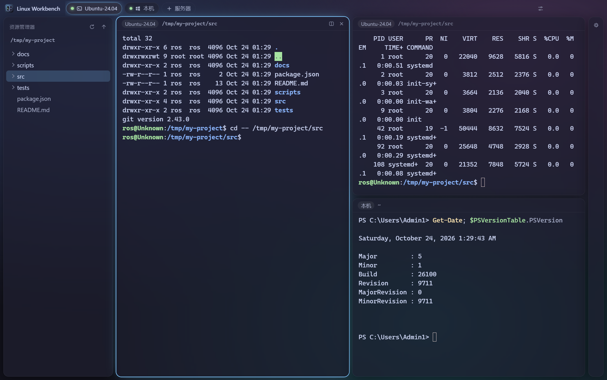
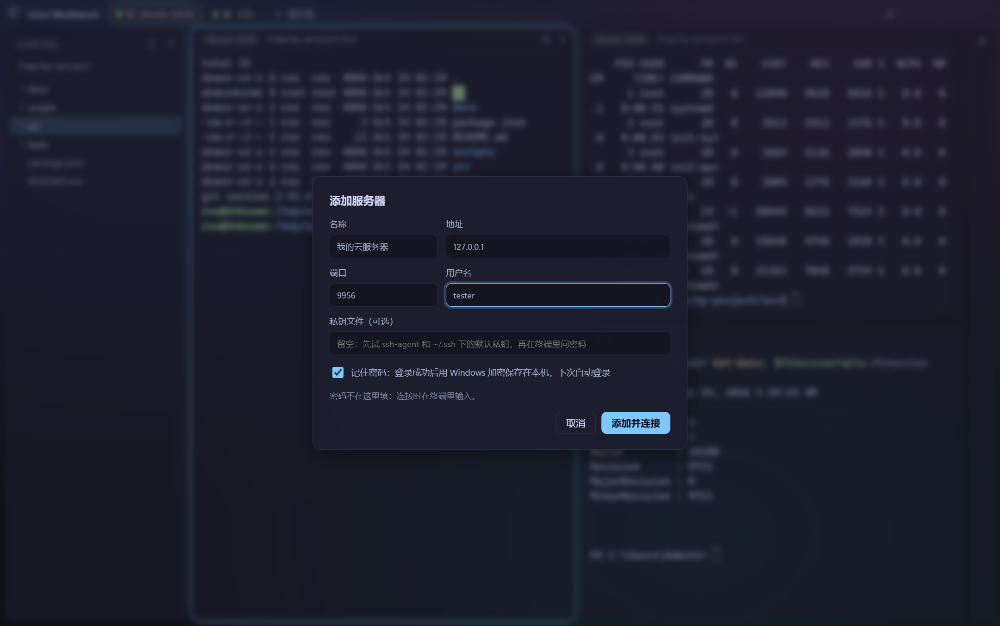
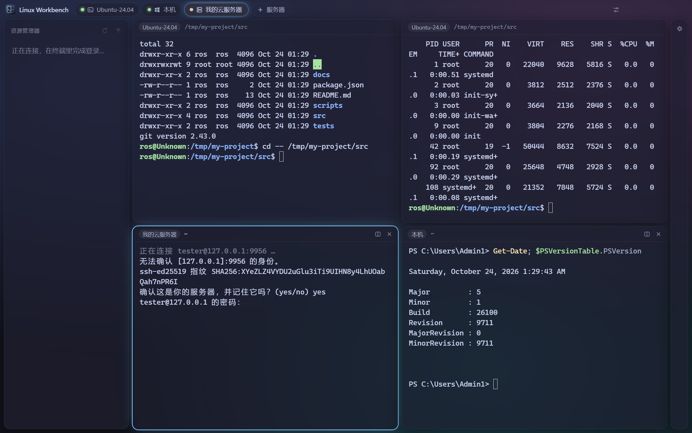
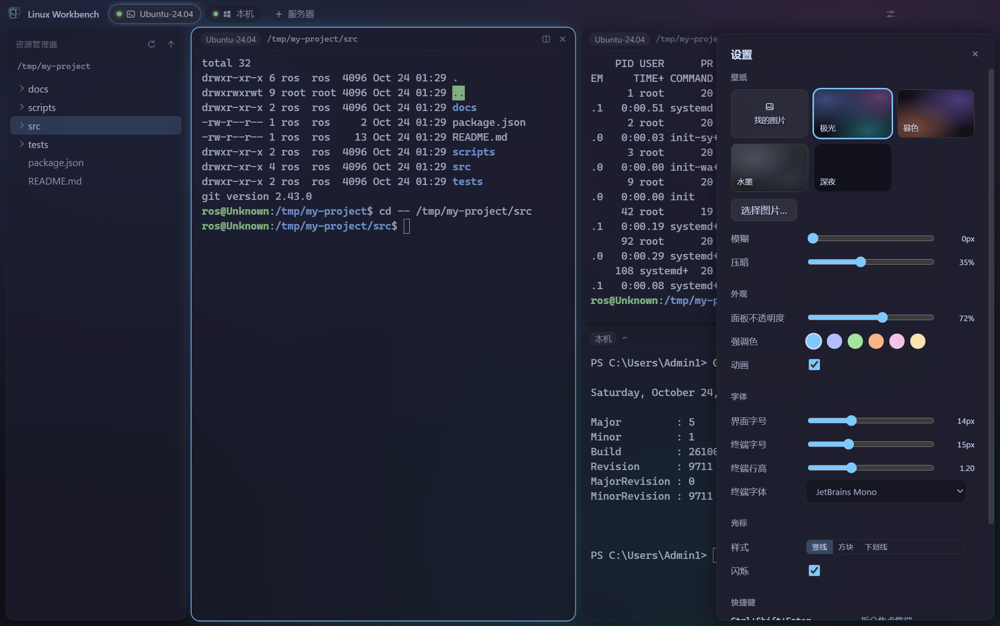

# Linux Workbench

在 Windows 上管理各种 Linux 的终端工作台：本机的 WSL 发行版、远程的云服务器、Windows 本机的 PowerShell，
都在一个窗口里——左边资源管理器，中间平铺终端，右边 agent CLI（Claude Code / Codex / Gemini）。

架构和设计取舍见 [ARCHITECTURE.md](ARCHITECTURE.md)。



| 添加服务器 | 在终端里登录 | 设置 |
| --- | --- | --- |
|  |  |  |

视觉参考 [openbit/wsl-sway](https://gitee.com/openbit/wsl-sway) 的 niri / sway 配置：壁纸铺底、半透明面板、
细描边焦点、柔和阴影，配色 Catppuccin Mocha。

技术栈：Electron + React + TypeScript + xterm.js + node-pty + ssh2，用 electron-vite 构建，electron-builder 打包。

## 安装

`npm run dist` 生成两个文件，在 `dist/` 里：

- `LinuxWorkbench-<版本>-setup.exe`：安装版，会建桌面和开始菜单快捷方式
- `LinuxWorkbench-<版本>-portable.exe`：免安装，双击直接用

没有代码签名，第一次运行 Windows 可能弹"已保护你的电脑"，点"更多信息 → 仍要运行"。

## 主机

- **WSL**：自动列出本机装的发行版（不含 docker-desktop），默认发行版启动时直接打开
- **本机**：Windows 自己的 PowerShell（装了 PowerShell 7 就用 pwsh），能直接用装在 Windows 上的 agent CLI
- **SSH 服务器**：标题栏点"+ 服务器"添加，可以从 `~/.ssh/config` 一键填入，私钥可以从 `~/.ssh` 里选：
  - 认证顺序和 ssh 命令一样：ssh-agent（Windows 的 OpenSSH agent 服务）→ 私钥 → 键盘交互 / 密码
  - 密码、私钥口令都在终端里问，不回显；输错可以重试，Ctrl+C 取消
  - 勾"记住密码"后，登录成功的密码用 Windows 的 DPAPI 加密保存在本机，下次自动登录；编辑服务器时可以清除
  - 第一次连接显示主机指纹，确认后记进应用自己的 known_hosts（不改 `~/.ssh/known_hosts`，但会读它）；
    和记录不一致时拒绝连接
  - 同一台服务器开多个终端共用一个连接，只登录一次；断线后按回车重连
- 点标题栏里的主机：已经有终端就切过去，没有就新开一个（SSH 这时开始连接）
- 资源管理器、双击 cd、拖放路径、agent 检测都按主机走：在哪台主机的终端里，就操作哪台主机

## 交互

| 操作 | 方式 |
| --- | --- |
| 新建终端（拆分焦点终端） | `Ctrl+Shift+Enter`，或标题栏的拆分按钮 |
| 关闭终端 | `Ctrl+Shift+W`、标题栏的 ×，或在 shell 里 `exit` |
| 显示 / 隐藏 agent 面板 | `Ctrl+Shift+A` |
| 设置 | `Ctrl+,`，或标题栏右侧的按钮 |
| 终端字号 | `Ctrl+=` / `Ctrl+-` / `Ctrl+0` |
| 复制 / 粘贴 | 有选中内容时 `Ctrl+C` 复制，`Ctrl+V` 粘贴（和 Windows Terminal 一样） |
| 调整大小 | 拖终端之间的缝隙（双击恢复对半）；拖 agent 面板左边缘 |
| 插入路径 | 把资源管理器里的文件 / 文件夹拖进同一台主机的终端或 agent |

- 拆分沿较长的边对半切，新终端在同一台主机、继承当前目录
- 双击文件夹让焦点终端 `cd` 过去；终端前台有程序（vim、`ros2 launch`、agent…）时不打字，只提示
- 终端标题和资源管理器高亮跟随终端的实际目录
- agent 面板标题栏可以选它跑在哪台主机上（WSL、本机、服务器），在登录 shell 里启动，环境和平时开终端一样；拖进 agent 插入 `@相对路径`

## 设置

壁纸（自己的图片或内置渐变，可调模糊和压暗）、面板不透明度、强调色、动画开关、界面和终端字号
（默认按 16 寸屏 150% 缩放：界面 14px、终端 15px）、终端字体、行高、光标样式。设置存在本地，改了立刻生效。

## 开发

需要 Node 22+；Windows 上不需要 VS 编译工具（node-pty 用自带的预编译版本）。

```bash
npm install
npm run dev          # 开发模式
npm run typecheck
npm test             # 单元测试：布局树、路径引号、启动脚本、known_hosts、ssh config、PowerShell
npm run smoke        # 冒烟测试（需要 WSL）：启动真实窗口，走一遍 WSL、agent、设置、平铺、本机、SSH
npm run icon         # 由 src/renderer/src/assets/icon.svg 生成 build/icon.ico 和 icon.png
npm run dist         # 打包 exe
```

冒烟测试会起一个只监听 127.0.0.1 的 SSH 测试服务器（密码 `test`，背后转发进 WSL），
数据目录用临时目录（`WORKBENCH_USER_DATA`），不碰真实的设置和服务器列表。

## 结构

```
src/
  main/
    index.ts            窗口、IPC
    sessions.ts         终端会话：创建、cd、当前目录、agent 检测
    wallpaper.ts        壁纸文件和 wb:// 协议
    secrets.ts          加密保存的服务器密码（safeStorage）
    hosts/
      registry.ts       主机列表：本机 / WSL / 保存的 SSH 服务器
      wsl.ts            WSL：wsl.exe + 常驻辅助进程执行命令
      windows.ts        Windows 本机：PowerShell，提示符报告当前目录
      ssh.ts            SSH：ssh2 连接、终端里的登录提示、主机密钥校验、保存的密码
      local.ts          应用跑在 Linux 上时的本机
      scripts.ts        在 Linux 主机上执行的 sh 脚本（启动 shell、列目录、读 /proc）
      ps-scripts.ts     Windows 本机的 PowerShell 脚本
      known-hosts.ts    known_hosts 解析和校验
      ssh-config.ts     ~/.ssh/config 解析
  preload/              通过 contextBridge 暴露 window.api
  shared/               三端共用：类型、agent 列表、路径引号
  renderer/src/
    App.tsx             状态：主机、平铺布局、焦点、agent、设置
    layout.ts           二叉分割树（纯函数）
    settings.ts         外观设置和默认值
    components/         TitleBar、Explorer、TilingView、TerminalPane、AgentPanel、SettingsPanel、HostDialog
tests/                  单元测试（node --test）
scripts/                冒烟测试、SSH 测试服务器、图标生成
```

## 已知限制

- WSL 和服务器上需要有 `sh`、`getent`、`base64` 和 `/proc`（主流发行版都有）；登录 shell 是 fish 时检测不到 agent
- Windows 本机的资源管理器不能跨盘符切换（从 C:\ 到 D:\），可以在终端里 `Set-Location D:\`
- 资源管理器不会自动刷新，用标题上的刷新按钮
